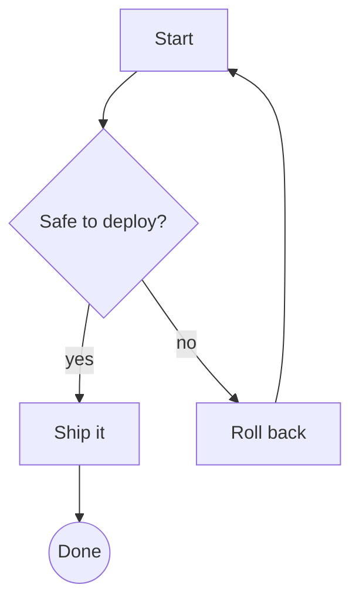
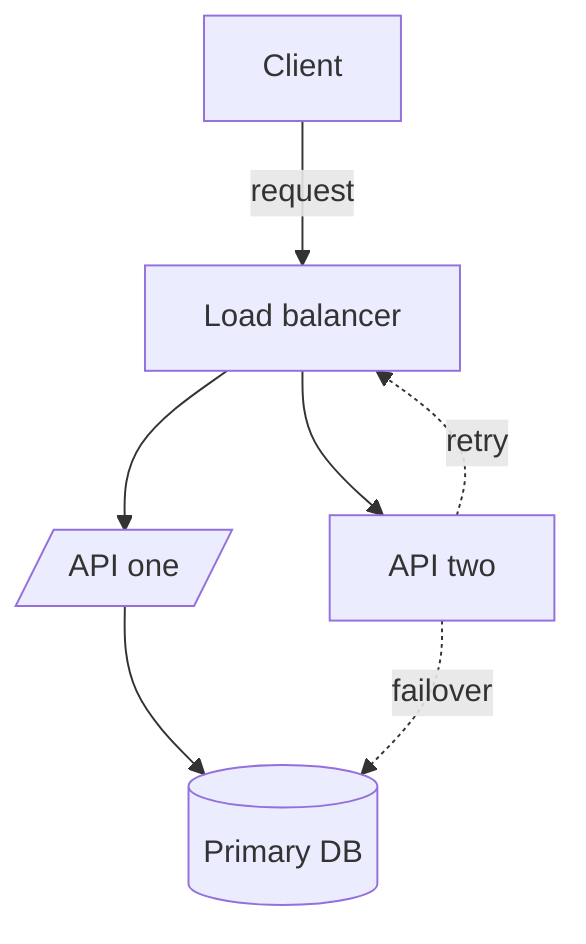
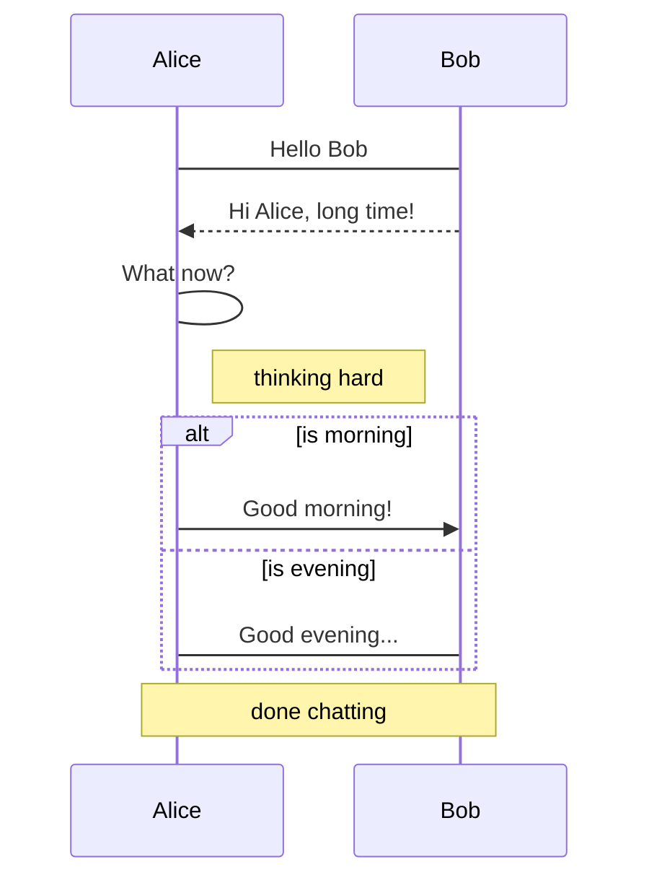
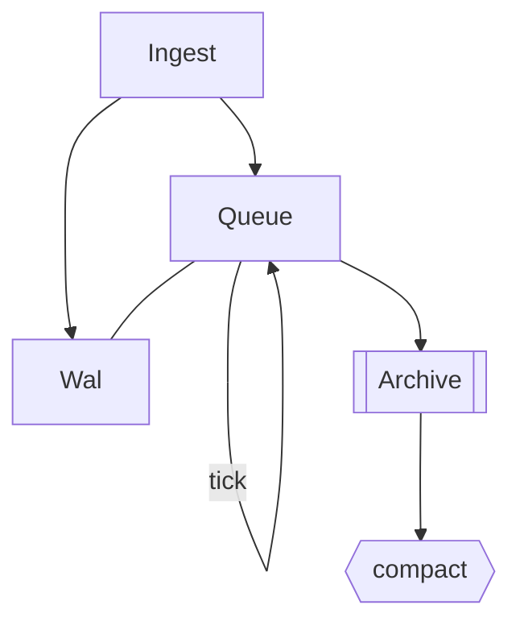
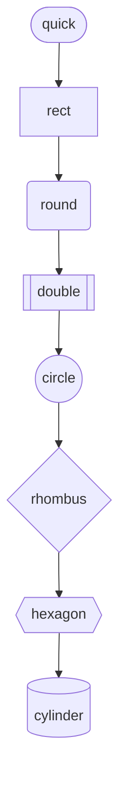
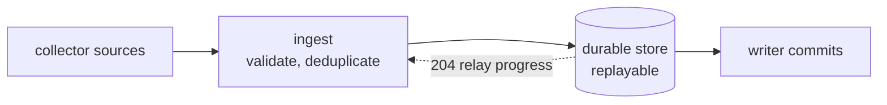
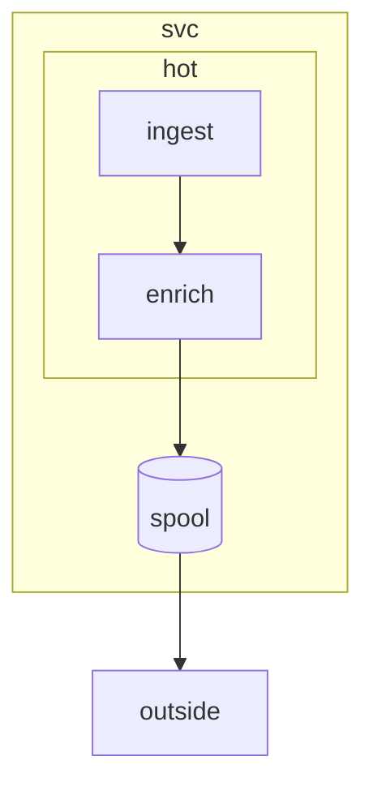
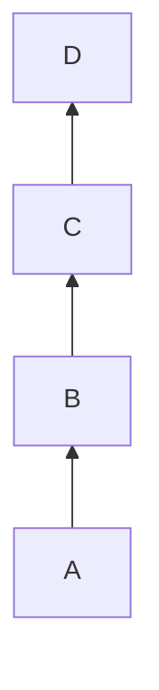

# Mermaid diagram examples

## Flowchart

## Sequence diagram

## Same-rank and self loop

## Shapes

## LR direction and multi-line labels

## Subgraph frames

## Unsupported (kept as source)

